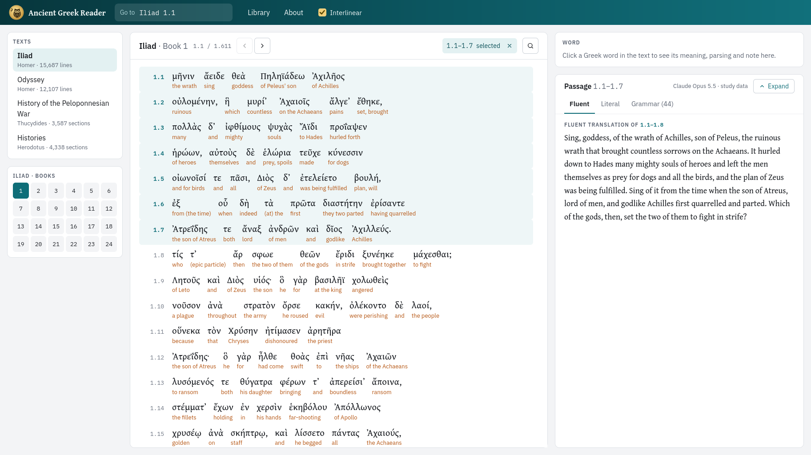

# Ancient Greek Reader

A reader for Ancient Greek in the browser: Homer's *Iliad* and *Odyssey*,
Herodotus and Thucydides, with every word's parsing, its role in the
sentence and its dictionary entry, and, in the books that have them, a
gloss and a note on every word and translations of every line.

**Read it online: [greek.kenaldo.dev](https://greek.kenaldo.dev)**



The reader only reads saved data: it asks no model anything, needs no
account, and keeps nothing about you on the server (where you stopped
reading stays in your browser). It works on a monitor, a laptop, a tablet
and a phone. The glosses, notes and translations were written once by
Claude Opus 5.5, Anthropic's model: **they can be wrong**, so check them
against the parsing and the dictionary. The reader tags them **AI**, and
the treebanks' parsing and LSJ's definitions **Perseus**, **GLAUx** and
**LSJ**.

More screens: [the Library](docs/screens/library-laptop.png),
[an iPad](docs/screens/reader-ipad.png), [a phone](docs/screens/reader-phone-word.png).

## What each text has

| Text | Parsing and roles | Glosses, notes and translations |
|---|---|---|
| Homer, *Iliad* | The Perseus treebank, annotated by hand | Every book |
| Homer, *Odyssey* | The Perseus treebank, annotated by hand | Coming |
| Herodotus, *Histories* | GLAUx: part by hand, the rest by its parser | Coming |
| Thucydides, *History of the Peloponnesian War* | GLAUx: part by hand, the rest by its parser | Coming |

Every text has the Greek (Perseus), search that ignores accents and
breathings, each word's parsing and role, LSJ's entry, how often its lemma
occurs, and the structure of each sentence. The Library labels each text and
book with what it has.

## Reading

- Each book is one page you scroll through; your place follows the scroll.
  **Go to** takes `Iliad 1.42`, `Odyssey 5`, or `1.42` in the text you are
  reading.
- Click (or tap) a word for its meaning, parsing, role in the sentence,
  dictionary form, use and LSJ's entry.
- Click a line number, then Shift+click another (on a touch screen, tap the
  first and the last) for the passage's fluent and literal translations and
  its grammar, word by word or as the outline of each sentence.
- **Interlinear** shows a gloss under every word.

[docs/reader.md](docs/reader.md) describes every screen and layout.

## Running it yourself

To read the texts, you don't need to: they are at
[greek.kenaldo.dev](https://greek.kenaldo.dev), with everything the
reader's database holds. To run the reader on your own computer, you need Docker, or Python 3.12 or
newer, and about 600 MB of disk for the data.

1. The code:
   ```bash
   git clone https://github.com/Kenaldo9/ancient-greek-reader.git
   cd ancient-greek-reader
   cp .env.example .env
   ```
2. Start it, with Docker:
   ```bash
   docker compose up -d          # http://localhost:8999
   ```
   The container runs as user and group 1000, so that files it writes into
   `data/` stay yours; if your IDs differ (`id -u`, `id -g`), set
   `GREEK_UID` and `GREEK_GID` in `.env`. After pulling new code, run
   `docker compose up -d --build`.

   Or with Python:
   ```bash
   python -m venv .venv
   source .venv/bin/activate
   pip install -r requirements.txt
   python greek.py web           # http://127.0.0.1:8000
   ```
3. The texts. The reader's own database is not offered for download for
   now; it may be published later, perhaps once every text has its
   glosses, notes and translations, but that is not decided
   ([docs/data.md](docs/data.md)). You can build one from the open
   sources, free (with Docker, `docker compose run --rm greek` in place of
   `python greek.py`):
   ```bash
   python greek.py fetch Homer       # pick the Iliad; note its text ID
   python greek.py study import-treebank TEXT_ID --work iliad
   python greek.py study import-lsj  # LSJ's entries for its lemmas
   ```
   The Library then shows the Iliad with its parsing and dictionary.
   Glosses, notes and translations are made with `greek study` batches,
   which need an Anthropic API key in `.env` and cost money
   ([docs/cli.md](docs/cli.md#greek-study)).

Newer code upgrades the database when it starts, after copying it beside
itself ([Database upgrades](docs/cli.md#database-upgrades)). The same
program is a command line too: `python greek.py --help`, or
`docker compose run --rm greek --help` ([docs/cli.md](docs/cli.md)). It can
read and search in the terminal, fetch more texts from Perseus, and make
study data (which needs an Anthropic API key in `.env`, and costs money).

## How the study data was made

`greek study` sent each passage of the Iliad (whole sentences, up to ten
lines) to Claude Opus 5.5 in Message Batches, with every word's lemma and
parse from the treebank, and saved the answers: a gloss and a note on each
word, a literal translation of each line, a fluent translation of the
passage, and a remark wherever the model disagreed with the treebank. Use
labels, dictionary forms, verb constructions and principal parts were made
the same way. Answers are checked when they are collected, and missing ones
asked again. The prompts are in [greek/api/](greek/api/) (`study.py`, `uses.py`,
`forms.py` and `parts.py`), made for each work from its profile in
[works.py](greek/api/works.py); [docs/data.md](docs/data.md) has the details.

## Sources and credits

- **Greek texts:** the [Perseus Digital Library](https://www.perseus.tufts.edu/)
  (Tufts University), [canonical-greekLit](https://github.com/PerseusDL/canonical-greekLit).
- **Parsing and syntax of Homer:** the [Ancient Greek Dependency Treebank 2.1](https://github.com/PerseusDL/treebank_data)
  (Perseus Digital Library).
- **Parsing and syntax of Herodotus and Thucydides:** the
  [GLAUx corpus](https://github.com/alekkeersmaekers/glaux) (Alek
  Keersmaekers, KU Leuven), with hand annotation from the
  [PROIEL treebank](https://github.com/proiel/proiel-treebank) (Dag Haug and
  others) and [Vanessa Gorman's treebanks](https://github.com/vgorman1/Greek-Dependency-Trees).
- **Dictionary:** Liddell, Scott and Jones, *A Greek-English Lexicon*
  (Perseus Digital Library, [lexica](https://github.com/PerseusDL/lexica)).
- **Glosses, notes, translations and word details:** Claude Opus 5.5
  (Anthropic).
- **Typefaces:** Gentium Book Plus (SIL International), IBM Plex Sans and
  IBM Plex Mono, under the SIL Open Font License
  ([greek/web/static/fonts/](greek/web/static/fonts/)).
- **[htmx](https://htmx.org)** 1.9.12, under the Zero-Clause BSD licence
  ([htmx-LICENSE.txt](greek/web/static/htmx-LICENSE.txt)), served from
  `greek/web/static/`.

## Licences

- **The code:** MIT ([LICENSE](LICENSE)).
- **The data:** each source keeps its own licence: CC BY-SA for the texts,
  the treebanks, LSJ and the study data, and CC BY-NC-SA (non-commercial)
  for the hand-annotated sentences of Herodotus and Thucydides.
  [DATA-LICENSE.md](DATA-LICENSE.md) has each one, by table, and how to
  leave out the non-commercial part.

## Mistakes and feedback

The reader is a hobby project, kept up as time allows. If a gloss, a note
or a translation is wrong, please
[open an issue](https://github.com/Kenaldo9/ancient-greek-reader/issues/new/choose)
or email [greek@kenaldo.dev](mailto:greek@kenaldo.dev), with the book and
line. There is no promise of a reply or of new features.

## Development

[ARCHITECTURE.md](ARCHITECTURE.md) explains how the code is put together,
and [CLAUDE.md](CLAUDE.md) its conventions, tests and screenshot checks.

```bash
pip install httpx                       # for the route tests
python -m pytest tests/ -q              # all tests
pip install playwright && playwright install chromium webkit   # optional browser tests
```

Tests use their own temporary databases and never call a model. Browser
tests skip when Playwright or a browser is missing.
